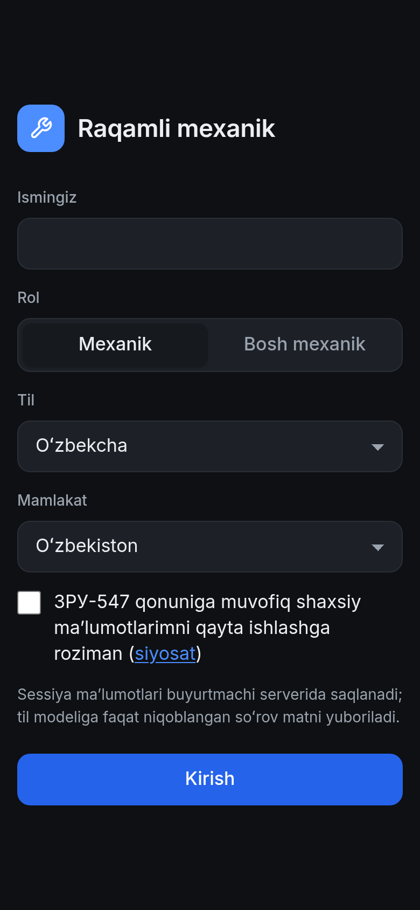

# Персональные данные по странам

На брифинге: если решение работает в сети — соответствие 152-ФЗ формально нужно. Что сделано в прототипе и что нужно при внедрении.

## Какие ПДн обрабатываются
| Данные | Зачем | Где |
|---|---|---|
| Имя (как ввёл пользователь), роль, язык, настройки | Вход, журнал действий | SQLite `var/app.db` |
| Тексты вопросов и ответов, действия (проверки, заявки, шаги ремонта) | История по машине, разбор случаев | SQLite, `var/app.log.jsonl` |
| Фото (госномер, узел) | Распознавание номера, описание неисправности | `var/uploads` |
| Голос | Распознавание вопроса | На сервере не хранится |
Данные машин (vehicles.json) синтетические, ПДн не содержат. Госномер ТС без связи с владельцем-физлицом ПДн не считается.

## Меры в прототипе
1. **Согласие** — при входе обязательная галочка со ссылкой на `/privacy` (`REQUIRE_CONSENT=1`), без неё вход невозможен.
2. **Обезличивание перед внешней моделью** — подробно в разделе «Что уходит с сервера» ниже. Коротко: ФИО, телефоны, e-mail, госномера, VIN, паспорт, СНИЛС, ИНН и номера карт заменяются метками на нашем сервере, модель получает только метки, в ответе метки заменяются обратно. В журнал и историю пишется текст с метками без номеров (`[ФИО]`, `[ТЕЛ]`); госномер и VIN в журнале остаются, по ним ищутся заявки и история машины (это машины парка, а не данные физлица).
3. **Срок хранения** — сообщения и журнал удаляются через `AUDIT_RETENTION_DAYS` (по умолчанию 90 дней), очистка при старте и не реже раза в час при входах пользователей.
4. **Права субъекта** — «Удалить мои данные» в настройках: профиль, сообщения и журнал пользователя удаляются, записи по машинам обезличиваются (`DELETE /api/me`).
5. **Разграничение доступа** — механик видит только свои диалоги; журнал и сводка по парку — роль «Главный механик».
6. **Внешние сервисы** — LLM получает только обезличенный текст (метки вместо ФИО, телефонов, госномеров, VIN); речь на стенде распознаёт **локальный** faster-whisper (сервис `speech` в compose, large-v3-turbo int8): аудио не покидает сервер, хранится только во временном файле на время распознавания и сразу удаляется; озвучка ответов (Silero) тоже локальная. По умолчанию (`STT_ORDER=local-first`) Deepgram — только резерв для поддерживаемых продуктовых языков, если локальный сервис недоступен; получает аудио с `mip_opt_out=true` (не использовать для обучения). На демо-стенде deb CPU занят другими задачами, поэтому для скорости голосового диалога включён `STT_ORDER=cloud-first` (ru/uz — Deepgram, ~1 с вместо 12–24 с; kk/ky/tg — локально или Cloud.ru в пределах настроенной матрицы). Для эксплуатации со строгим 152-ФЗ — одна строка `STT_ORDER=local-first` в `.env`. На резервном стенде Vercel речь распознаёт браузер. Ключи — только в переменных окружения, в логи не пишутся.
7. **Локальное хранение** — всё в SQLite на сервере приложения (том `./var` в docker compose), без сторонних облачных БД.

## Что уходит с сервера: обезличивание (для жюри)
Любой текст, который отправляется во внешнюю языковую модель (TokenRouter или Cloud.ru: вопрос, история диалога, карточка машины, фрагменты руководства, перевод, выжимка цитаты), сначала проходит через локальный модуль `src/digital_mechanic/pii.py`. Он работает на нашем сервере, без сети и без нейросетей, только на правилах и словаре.

| Что ищем | Пример | Что видит модель |
|---|---|---|
| ФИО: фамилия с инициалами, имя с отчеством, имя с фамилией, «механик Петров», частые имена | «Петров Б.», «Иван Петрович», «Сергей, проверь» | `[ФИО_1]` |
| Телефон: +7, 8, 8 (9xx), +998 / +7 7xx / +992 / +996 / +375 / +84 / +91 / +880 | «+7 912 345-67-89» | `[ТЕЛ_1]` |
| E-mail | «ivanov@mail.ru» | `[EMAIL_1]` |
| Госномер РФ, кириллица и латиница, с пробелами и без | «M333YK47», «м851та178», «А 123 ВС 777 RUS» | `[ГОСНОМЕР_1]` |
| VIN (17 знаков, без I/O/Q, последние 4 — цифры) | «XTC65115081234567» | `[VIN_1]` |
| Паспорт, СНИЛС, ИНН (со словом-признаком), номер карты | «паспорт 4510 123456», «СНИЛС 112-233-445 95» | `[ПАСПОРТ_1]`, `[СНИЛС_1]`, `[ИНН_1]`, `[КАРТА_1]` |

Как это работает:
1. Перед вызовом модели (`Llm.chat`) все сообщения копируются, и в копии персональные данные заменяются метками. Одно и то же значение в пределах запроса получает одну и ту же метку: «M333YK47» и «м333ук47» дадут один `[ГОСНОМЕР_1]`.
2. Таблица «метка → значение» живёт только в памяти сервера на время одного запроса. Она нигде не сохраняется и не уходит наружу.
3. В ответе модели метки заменяются обратно. При потоковом ответе тоже: если кусок текста заканчивается на «[ФИ», он придерживается до следующего куска, и на экране никогда не бывает половины метки. В аргументах вызовов инструментов метки тоже восстанавливаются, поэтому поиск по госномеру работает с настоящим номером.
4. Названия техники и технические обозначения не трогаются: ЯМЗ-536, КАМАЗ-65115, ПАЗ-3204, ЗМЗ-40904.10, коды P0101, SPN/FMI, F03, номера деталей (840.1012075), моменты, зазоры, давления. Проверено тестами и прогоном по всем 4 147 страницам руководств: госномеров, VIN и паспортов не найдено ни одного, а найденные ФИО и e-mail — настоящие (авторы руководств, адреса сервисных служб).
5. В журналах использования (расход токенов, трассировка Opik) текста запроса нет, а то, что получает провайдер модели, уже обезличено. В журнал действий и историю диалогов пишется текст с метками без номеров.
6. Обезличивание включено по умолчанию (`PII_MASKING=1`). Инженер видит в своём меню плашку «Обезличивание: вкл», число замен и среднее время. Выключить его можно только для отдельной компании (карточка компании → «Обезличивание перед моделью»), например если с заказчиком подписан договор поручения обработки и модель размещена у него.

Задержка (замер 27.11 на машине разработки, Python 3.13): 0,3 мс на вопрос из 500 знаков, 5,9 мс на запрос из 12 000 знаков с фрагментами руководства, 12 мс на 25 000 знаков; живой вопрос с ФИО и госномером через бесплатную модель — в среднем 1,75 мс на вызов, максимум 4,6 мс (замер `tests/test_pii.py::test_latency_under_50ms_on_a_large_prompt`, цель < 50 мс). На время ответа это не влияет: модель отвечает 10–25 с.

Чего модуль не делает: он не ищет адреса и даты рождения и не распознаёт редкие имена без фамилии. Для эксплуатации это закрывается моделью в контуре РФ (GigaChat в Cloud.ru, `LLM_PRIMARY=auto`) и договором с оператором.

## Что нужно при внедрении (не код)
- Оператор ПДн — автопарк; уведомление Роскомнадзора об обработке, локальный акт (политика обработки ПДн), назначение ответственного.
- Сервер в РФ (ч. 5 ст. 18 — первичный сбор и хранение ПДн граждан РФ в РФ).
- LLM и STT — размещённые в РФ (YandexGPT/GigaChat, SpeechKit/SaluteSpeech) или локальные модели: меняется `LLM_BASE_URL`/`LLM_MODEL`, для речи — локальный faster-whisper. Иначе — трансграничная передача (ст. 12) с отдельным уведомлением.
- Вход через учётные записи парка (SSO/AD) вместо имени; HTTPS (обратный прокси).
- Модель угроз и уровень защищённости ИСПДн (ПП РФ № 1119) — по итогам внедрения; для такого объёма обычно УЗ-4.

## Персональные данные по странам

На экране входа выбирается страна (по умолчанию Россия). От страны зависят текст согласия (на языке интерфейса, с названием закона),
страница `/privacy?country=XX` и маршрут распознавания речи. Страна хранится в профиле пользователя и меняется в настройках.
Код: `src/digital_mechanic/privacy_laws.py`. Проверено по первоисточникам 26.11.2026.

| Страна | Закон | Локализация | Распознавание речи |
|---|---|---|---|
| Россия (по умолчанию) | Федеральный закон от 27.07.2006 № 152-ФЗ «О персональных данных» | да, ч. 5 ст. 18 | локально, облако только если локальное недоступно |
| Узбекистан | Закон РУз от 02.07.2019 № ЗРУ-547 «О персональных данных» | ст. 27¹ в ред. ЗРУ-1125 от 26.03.2026: обязательно в РУз хранятся биометрические и генетические данные (и данные абонентов связи); остальное можно за рубежом при адекватной защите (перечень КМ № 415) | локально (голос может считаться биометрией) |
| Казахстан | Закон РК от 21.05.2013 № 94-V «О персональных данных и их защите» | да, п. 2 ст. 12 | локально |
| Кыргызстан | Цифровой кодекс КР от 31.07.2025 № 178 (в силу с 05.02.2026); Закон КР от 14.04.2008 № 58 «Об информации персонального характера» утратил силу | общей нет (ст. 31); перечень стран с адекватной защитой не опубликован, передача за рубеж по согласию или договору (ст. 89) | локально; киргизской речи нет в локальной модели (Whisper), поэтому ky распознаётся только облаком (Deepgram nova-3) и только при согласии на облако |
| Беларусь | Закон РБ от 07.05.2021 № 99-З «О защите персональных данных» в ред. Закона от 16.03.2026 № 134-З | нет; передача только в страны с надлежащей защитой (участники Конвенции 108 и ЕАЭС, приказ НЦЗПД № 14), иначе согласие с предупреждением о рисках (ст. 9) | локально |
| Таджикистан | Закон РТ от 03.08.2018 № 1537 «О защите персональных данных» | прямого требования нет | по настройке стенда |
| Индия | Digital Personal Data Protection Act, 2023 (No. 22 of 2023); DPDP Rules, 2025 (G.S.R. 846(E), 13.11.2025; основные обязанности с 13.05.2027) | общей нет | по настройке стенда |
| Вьетнам | Luật Bảo vệ dữ liệu cá nhân № 91/2025/QH15 и Nghị định 356/2025/NĐ-CP, оба с 01.01.2026 | нет; трансграничная передача — с досье (форма 09) | по настройке стенда |

Важно: Постановление 13/2023/NĐ-CP (Вьетнам), которое было в исходном списке, утратило силу 01.01.2026 (ст. 42 Постановления 356/2025/NĐ-CP),
поэтому в приложении указан действующий закон 91/2025/QH15.

Источники: lex.uz/acts/4396428 (ЗРУ-547, ст. 27¹); zan.adilet.kz (№ 94-V, ст. 12); base.mmk.tj и natlex.ilo.org (РТ № 1537);
cbd.minjust.gov.kg (Цифровой кодекс КР № 178); pravo.by (№ 99-З, № 134-З); egazette.gov.in (DPDP Rules, G.S.R. 843(E)/846(E)); congbao.chinhphu.vn (Luật 91/2025/QH15).

